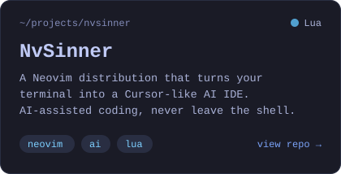
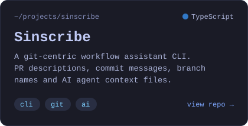
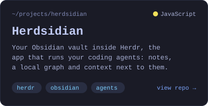

  

  <strong>Hi, I'm Andersson Quintero</strong>, a Senior Full-Stack Engineer in Buenos Aires 🇦🇷. 
  I have spent 9+ years shipping web and mobile products end to end, from NestJS microservices to Vue, React and React Native apps. 
  In my free time I build developer tools for people who live in the terminal.

  
  
  
  

## 📂 Open source &nbsp;<code>:e ~/projects</code>

  
  
  

## 🤝 Work with me &nbsp;<code>:help hire</code>

| 🛠️ Freelance clients | 💼 Companies | 🌱 Community |
| --- | --- | --- |
| Web and mobile apps, APIs and frontend architecture, from idea to production. | Senior full-stack roles: Vue and React frontends, NestJS microservices, team DX. | Issues, ideas and pull requests are welcome on NvSinner, Sinscribe and Herdsidian. |
| **→ [andersoftware.com](https://andersoftware.com)** | **→ [Résumé (PDF)](https://andersoftware.com/cv-andersson-quintero.pdf)** | **→ [My repositories](https://github.com/anderssonq?tab=repositories)** |

## 🚧 Right now &nbsp;<code>:checkhealth</code>

- **[Qu POS](https://www.qubeyond.com/)**: intelligent restaurant commerce platform. Unified POS, kitchen solutions and payments for QSR and fast-casual brands.
- **[andersoftware.com](https://andersoftware.com)**: my dev hub for freelance projects, side work and experiments.

## 🧰 Stack &nbsp;<code>:Lazy</code>

   
  

## 👤 Off the clock &nbsp;<code>:!whoami</code>

- 🎓 B.Sc. in Computer Science, UCLA, Venezuela
- 🎸 Learning electric bass, self-taught
- 🏋️ Gym and paddle tennis

<strong>📊 GitHub stats</strong>

 

  
  

<code>:wq</code> &nbsp;·&nbsp; thanks for stopping by

